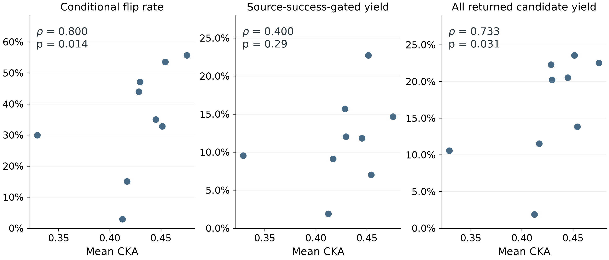

::: {.study-lead}
An attack that changes one classifier's prediction may also change another's. This study tests how hidden-representation similarity relates to those target changes. Ten [surrogates](guide.qmd#surrogate){.term-help} receive five adapted TextAttack recipes, followed by local target checks. The association depends on whether the analysis conditions on source success or counts every returned candidate.
:::

::: {.action-row}
[Read the paper](paper.qmd){.action-link}
[Download the paper (PDF)](paper.pdf){.action-link}
[Open the study guide](guide.qmd){.action-link}
[Browse the code](https://github.com/turn1a/safety-classifier-transfer-risk){.action-link}
:::

::: {.metric-grid aria-label="Audited results"}
<div class="metric-card">
<p class="metric-value">ρ = 0.800</p>
<p class="metric-label"><a class="term-help" href="guide.html#macro">Conditional flip association</a><br>Nine transformers; source-success-conditioned macro rate; p = 0.014</p>
</div>
<div class="metric-card">
<p class="metric-value">ρ = 0.400</p>
<p class="metric-label"><a class="term-help" href="guide.html#yield">Source-success-gated yield association</a><br>The same nine transformers; fixed attempted-trial denominator; p = 0.29</p>
</div>
<div class="metric-card">
<p class="metric-value">ρ = 0.733</p>
<p class="metric-label"><a class="term-help" href="guide.html#all-candidate-yield">All-candidate yield association</a><br>All returned candidates from nine transformers; p = 0.031</p>
</div>
<div class="metric-card">
<p class="metric-value">16.3%</p>
<p class="metric-label"><a class="term-help" href="guide.html#all-candidate-yield">All returned candidate yield</a><br>1,403 target changes / 8,595 transformer trials, including 405 from failed source searches</p>
</div>
:::

::: {.study-status}
The source models and attack candidates come from the completed sweep. Local reevaluation adds target outcomes for failed source searches, clean-input checks, and a pending human review. No training or attack search was repeated. The affected BiLSTM is excluded from the new comparisons; [model fixes and a controlled redesign](recomputation.md) have no replacement experimental results.
:::

## How transfer was counted

::: {.hero-figure}
{fig-alt="The audit starts with 9,550 source evaluations, records 4,362 source successes, and separates all four target prediction transitions, including 1,054 injection-to-benign changes." width=100%}
:::

The sweep has 9,550 attempted source evaluations over 191 distinct positive test inputs. It skips 950 baseline source misses, leaving 8,600 eligible attempts and 4,362 [source successes](guide.qmd#source-success){.term-help}. The audit finds 1,054 [verified injection-to-benign changes](guide.qmd#verified-flip){.term-help} among 4,009 successful records with target-positive originals, a pooled conditional rate of 26.3%. The counts refer to attack records: originals repeat across models and recipes. The target-positive baseline comprises 167 distinct originals.

The historical conditional target-benign metric is 1,398 / 4,362 = 32.0%. It includes 344 records whose original and perturbation are both target-benign. The [target audit summary](artifacts/target_audit_summary.json) separates these transitions. Verified prediction changes do not establish semantic preservation or operational evasion.

## Study design

The deduplicated corpus combines [deepset prompt injections](https://huggingface.co/datasets/deepset/prompt-injections), [jackhhao jailbreak classification](https://huggingface.co/datasets/jackhhao/jailbreak-classification), and [Lakera Gandalf examples](https://huggingface.co/datasets/Lakera/gandalf_ignore_instructions). Its 2,947 rows use a positive label that mixes prompt-injection and jailbreak-style material. Every surrogate receives every recipe. Similarity groups organize the subsequent analysis; attack generation uses no target prediction feedback. The [study guide](guide.qmd) links all models and explains the source labels.

```{mermaid}
flowchart TD
  P["Balanced representation probe"] --> C["Full-probe layer-wise CKA and DBS"]
  C --> G["Empirical M1, middle, and M2 groups"]
  E["191 positive test inputs"] --> A["All ten surrogates, all five recipes"]
  A --> S["4,362 successful source-attack records"]
  S --> T["Target audit of originals and perturbations"]
  T --> R["Surrogate macro rates and procedure yield"]
  G --> R
  R --> O["Association, selection contrast, and sensitivities"]
```

The evaluator needs target weights and hidden representations for CKA. This is an evaluation among public local classifiers, without an opaque-service access constraint. Originals are clipped to 3,200 characters before search; 13 of the 191 inputs exceed that limit. Subsequent model tokenizers apply their own 512-token windows.

## Outcomes by model and recipe

::: {.hero-figure}
{fig-alt="A ten-surrogate by five-recipe heatmap shows conditional audited rates and their exact denominators." width=100%}
:::

::: {.reader-note}
Click the heatmap to enlarge it. Rates condition on successful source attacks and a target injection baseline, so different cells have different denominators. Model identifiers link to their descriptions in the paper's [surrogate result table](paper.qmd#tbl-surrogate-results).
:::

## Association and sensitivities

{fig-alt="Three panels compare CKA with outcome definitions: rho 0.800, 0.400, and 0.733." width=100%}

The source-success-gated yield correlation is 0.400 (p = 0.29), compared with 0.800 (p = 0.014) for conditional macro transfer. Scoring all returned candidates gives 0.733 (p = 0.031). Probabilities describe a designed-pool exchangeability null. The selected three models produce 424 source-success-gated flips in 2,865 trials (14.8%); eleven observed three-model choices produce more. These post-hoc results establish no held-out selection rule.

Across ten surrogate macro summaries, mean CKA has Spearman rho = 0.830 and exact two-sided p = 0.0047 under an exchangeability null for the designed pool. M1 and M2 means are 47.3% and 14.3%, a 33.1-percentage-point difference. The one-sided enumeration has only 20 allocations and cannot meet the project's strict p < 0.05 rule.

Excluding the known shared source `jackhhao/jailbreak-classification` gives rho = 0.903 and p = 0.00081. The training-only CKA probe gives rho = 0.818 and p = 0.0058 against unchanged outcomes. Both M1 and M2 membership sets remain unchanged. These are post-hoc within-pool sensitivities, without external validation or established decontamination.

The historical BiLSTM includes padding in its recurrent computation, attention, and pooled representations. Its output can depend on batch companions. Excluding its saved cells gives rho = 0.800 and p = 0.014 among nine transformers. This [sensitivity](guide.qmd#sensitivity){.term-help} does not correct the model's saved outcomes. Padding and fresh-head seeding fixes are on the [correction branch](https://github.com/turn1a/safety-classifier-transfer-risk/tree/codex/methodology-recompute). The reported predictions and attacks were produced with the historical implementation; no replacement experiment was run.

## Implementation and local reanalysis

The [pure core](https://github.com/turn1a/safety-classifier-transfer-risk/tree/main/src/transfer_risk/lib) contains CKA, DBS, seeds, statistics, and audit aggregation. Kedro nodes execute models and attacks, and the catalog owns input and output artifacts. The original attack sweep used an ARM64 AWS `r8g.48xlarge` Graviton4 spot instance with 192 vCPUs. Reductions, target auditing, and reporting ran locally.

`just paper-report` regenerates manuscript tables, figures, fixed-trial associations, and common-source checkpoint comparisons from public aggregates and configuration. `just docs` renders the site. The [implementation page](pipeline.qmd) describes the execution stages and saved-output boundaries.

The [validity guide](validation.qmd) explains the broad 278-pair audit, the separate staged review of 1,318 target-changing pairs, and completed local embedding/NLI screens. A fixed sample of 300 changed trial occurrences is displayed as 291 first-stage pairs, followed by 1,027 remaining pairs. Genuine judgments are pending.

{fig-alt="The staged review draws 300 of 1,403 changed occurrences, displays 291 sampled pairs, and retains 1,027 further pairs for the full 1,318-pair review." width=100%}

 The scores diagnose text changes; they supply no semantic-validity labels. No downstream application effectiveness rate is available. Clean-input checks also show different behavior: deepset flags 60 of 104 canonical benign inputs, while ProtectAI and Prompt Guard 22M flag none in this sample.

## Limits

The target card excludes jailbreak detection from its stated scope, while the evaluation's positive label includes jailbreak material. The adapted recipes substitute a semantic encoder and bypass some short-input checks; accepted perturbations are not systematically adjudicated for meaning preservation. Source-success cohorts differ by model, so conditional transfer and the yield under a fixed trial budget are distinct.

The original head initialization was not controlled by the training seed, and immutable Hub revisions and a cross-stage target fingerprint were not retained. Saved-checkpoint analysis is inspectable, but exact fresh retraining and model identity across every stage were not established. [Recomputation notes](recomputation.md) identify the defects, branch corrections, and possible changes to results. Their direction and magnitude remain unknown until retraining and attack regeneration.

This study measures bounded classifier transfer behavior and does not certify robustness.

## Paper and artifacts

::: {.action-row}
[Inspect the implementation](pipeline.qmd){.action-link}
[Open target audit summary](artifacts/target_audit_summary.json){.action-link}
[Open pool sensitivity](artifacts/surrogate_excluded_sensitivity.json){.action-link}
:::

The primary aggregate artifacts are [target audit cells](artifacts/target_audit_cells.csv), [source aggregates](artifacts/target_audit_sources.csv), [training-probe similarity](artifacts/training_probe_similarity.csv), and the [results manifest](artifacts/results_manifest.json). The [historical conditional table](artifacts/master_results_table.csv) remains secondary. Raw prompts, perturbations, private matrices, and checkpoints are excluded from the public site.

::: {.term-definitions-hidden aria-hidden="true"}

:::
