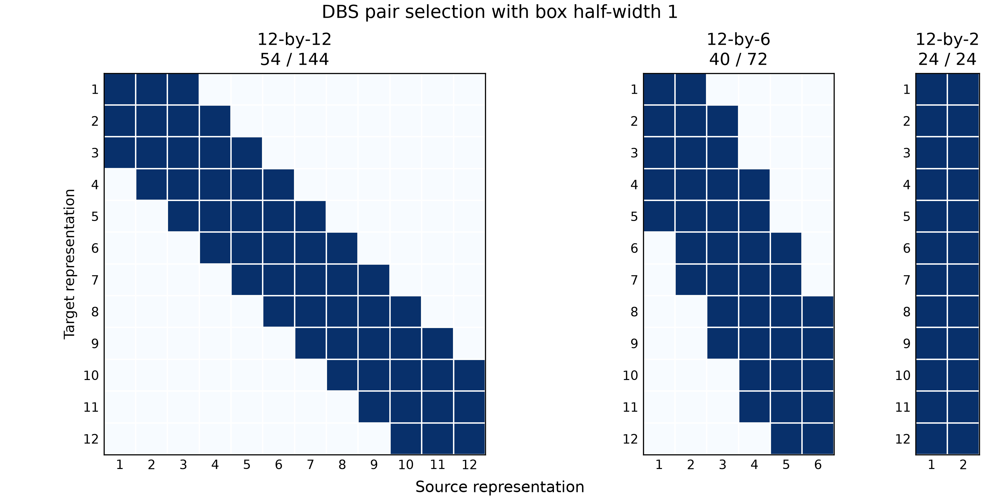
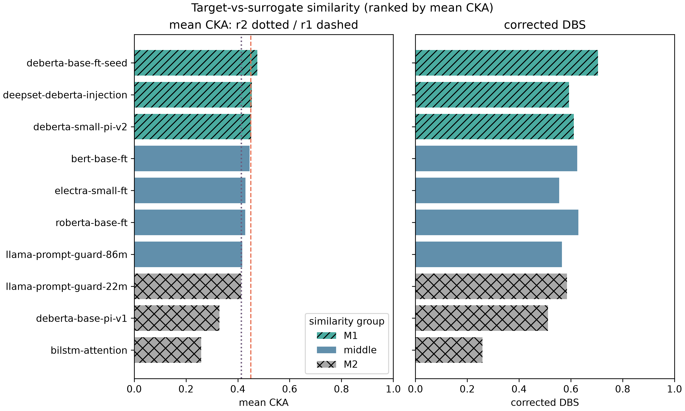
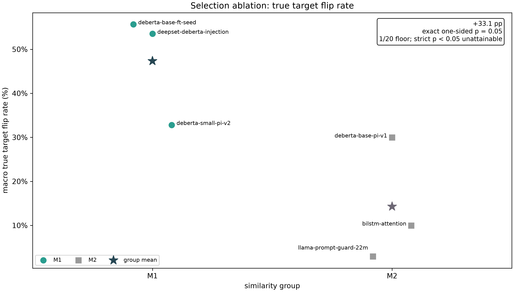
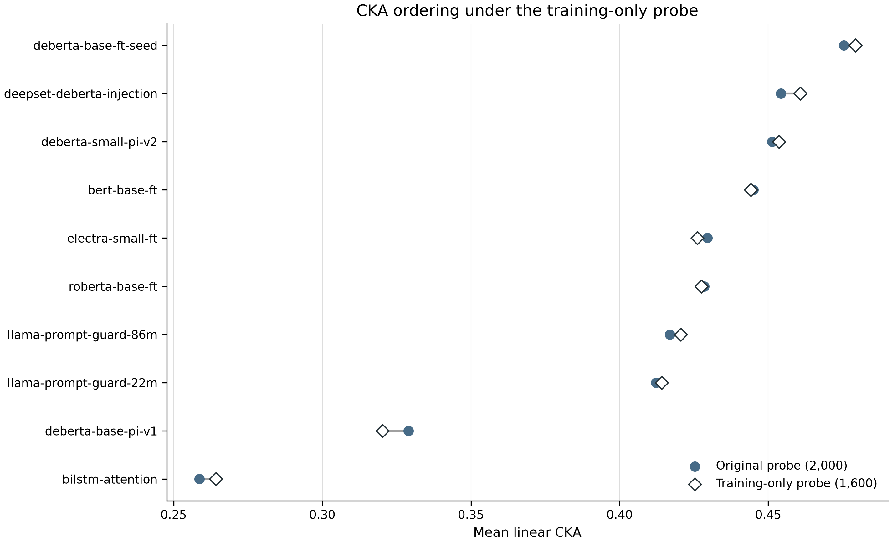

::: {.content-visible when-format="html"}
::: {.action-row}
[Download the paper (PDF)](paper.pdf){.action-link}
[Open the study guide](guide.qmd){.action-link}
:::

::: {.reader-note}
Table headers link to metric definitions and show help on hover or keyboard focus. Click a figure to open a larger view.
:::
:::

## Introduction

A text safety classifier can be evaluated through attacks developed against an accessible surrogate. When a perturbation changes the surrogate's prediction, applying it to a separate target tests whether that prediction change transfers. Prompt-injection detection is one application of this procedure: a detector classifies untrusted text before it enters a language-model workflow [@owasp-llm01-2025]. This study asks whether representational similarity is associated with target prediction changes, and how that association depends on conditioning on source success or retaining a fixed attempted-trial denominator.

The target is [`protectai/deberta-v3-base-prompt-injection-v2`](https://huggingface.co/protectai/deberta-v3-base-prompt-injection-v2), an English detector whose model card was marked archived and no longer maintained as of July 2026 [@protectai-2024]. The study adapts the CKA-guided selection workflow of Cox and Bunzel [@cox-bunzel-2025] to text classification. Every surrogate receives every attack recipe; the similarity groups organize the analysis of those outcomes. The target is available locally to the evaluator, including its hidden representations. Attack generation queries source models only.

The analysis distinguishes three outcomes: a conditional flip rate after source success, source-success-gated flips per attempted trial, and target changes among all returned candidates. Recipe-level outcomes are aggregated to one analysis unit per surrogate. Published counts and sensitivity outputs permit inspection without releasing prompt text. A separate human-review workflow addresses meaning and injection intent; classifier prediction changes alone do not establish either.

## Related work

Yuan et al. examine how architecture, tokenization, embeddings, and capacity affect adversarial transfer between neural text classifiers, including ensemble-based generation [@yuan-etal-2021-transferability]. He et al. show transfer from an extracted BERT surrogate to a target API under limited queries and architecture mismatch [@he-etal-2021-model]. These studies establish surrogate-based evaluation as a text-classification method, but do not determine which surrogate-selection signal or outcome definition should be used here.

Hackett et al. study evasion of prompt-injection and jailbreak detectors, including transfer from ProtectAI v2 to Azure Prompt Shield [@hackett-etal-2025-bypassing]. The present experiment ranks a heterogeneous surrogate pool by CKA and audits original target predictions for successful source attacks. SEP-Attack develops transfer-oriented textual attacks using diverse surrogate ensemble weights [@liu-etal-2026-sep]. The current study holds its implemented recipes fixed to examine similarity and target outcomes under a common suite.

Liu evaluates fifteen detectors on application tool outputs and BIPIA, reporting poor transfer of detection rankings and substantial false-positive variation [@liu-2026-detector-deployment]. The current experiment's clean-input and training-exposure checks address related concerns, while application-specific detector validation remains absent.

Cox and Bunzel propose selecting high- and low-similarity surrogates for transferred attack evaluation [@cox-bunzel-2025]. Klause and Bunzel introduce related DBS analyses in convolutional networks [@klause-bunzel-2025]. Linear CKA compares activation matrices and is invariant to orthogonal rotation and isotropic scaling [@kornblith-2019]. Gupta et al. distinguish transfer behavior of representation-space and data-space attacks [@gupta-etal-2025-understanding]. The attacks here modify text inputs. CKA is an analysis signal; this experiment does not identify the mechanism causing attack transfer.

## Data and models

### Corpus and held-out evaluation

The canonical corpus combines [`deepset/prompt-injections`](https://huggingface.co/datasets/deepset/prompt-injections), [`jackhhao/jailbreak-classification`](https://huggingface.co/datasets/jackhhao/jailbreak-classification), and [`Lakera/gandalf_ignore_instructions`](https://huggingface.co/datasets/Lakera/gandalf_ignore_instructions) [@deepset-prompt-injections; @jackhhao-jailbreak-classification; @lakera-gandalf-ignore-instructions]. Deepset provides numeric labels, jackhhao provides `benign` and `jailbreak` labels, and Lakera contributes positive examples. The canonical positive label therefore includes both prompt injections and jailbreak-style material.

Text normalization lowercases and collapses whitespace for exact deduplication. No rows fail the three-character minimum. Removing 21 duplicates leaves 2,947 rows, with no recorded cross-source exact overlaps. A seeded stratified 80/10/10 split produces the partitions in @tbl-data. The 191 positive test examples are all used in each surrogate-recipe cell. Their source composition is 101 Lakera, 63 jackhhao, and 27 deepset examples; these counts describe distinct evaluation inputs.

| Partition or stage | Rows | Positive | Benign |
| --- | ---: | ---: | ---: |
| Raw combined corpus | 2,968 | Not retained in public audit | Not retained in public audit |
| Deduplicated corpus | 2,947 | 1,910 | 1,037 |
| Training | 2,357 | 1,528 | 829 |
| Validation | 295 | 191 | 104 |
| Test | 295 | 191 | 104 |
| Attack evaluation inputs | 191 | 191 | 0 |

: Corpus preparation and saved split counts. {#tbl-data tbl-colwidths="[35,15,25,25]"}

The post-deduplication source counts are 1,286 jackhhao, 999 Lakera, and 662 deepset rows, as recorded in the [dataset audit](artifacts/dataset_audit.json). The target card lists jackhhao among its training sources. Its complete training mixture and record identifiers are unavailable, so record-level decontamination was not established.

### Target and surrogate pool

The target predicts class 0 for benign and class 1 for injection. Its card specifies English prompt-injection detection, excludes jailbreak detection from its stated capabilities, and illustrates a 512-token window [@protectai-2024]. Evaluation uses the argmax of the classifier logits, without tuning a confidence threshold.

The pool has five pretrained detectors, four locally fine-tuned transformers, and one BiLSTM trained from scratch (@tbl-models). Pretrained detectors retain their original weights and objectives. Canonical validation accuracy was recorded for the locally trained models only. It is calculated on the same 295-row validation partition after the final training epoch. A subsequent clean-input check evaluates the saved transformer checkpoints and target on all 295 test rows, with 191 canonical positives and 104 canonical benign examples. It uses the attack-stage clipping and token windows, and is separate from the recorded validation accuracy.

Source attacks pass canonical class 1 to every recipe and use each model's native binary logit order, without a per-model label remapping. The locally trained classifiers use 0 for benign and 1 for the canonical positive label. Saved ProtectAI and deepset configurations explicitly identify class 1 as injection; the Prompt Guard 2 configurations omit semantic label names, but Meta's inference utilities identify class 1 as malicious [@meta-prompt-guard2-inference]. Prompt Guard's malicious class covers explicit attempts to override prior instructions, including jailbreaks, while the target's card specifies prompt-injection detection [@meta-prompt-guard2]. Numeric class order is shared, while the positive objectives differ.

| Surrogate identifier | Model or backbone | Preparation | Validation accuracy (%) |
| --- | --- | --- | ---: |
| `deberta-base-pi-v1` | [`protectai/deberta-v3-base-prompt-injection`](https://huggingface.co/protectai/deberta-v3-base-prompt-injection) | Pretrained detector | Not measured |
| `deberta-small-pi-v2` | [`protectai/deberta-v3-small-prompt-injection-v2`](https://huggingface.co/protectai/deberta-v3-small-prompt-injection-v2) | Pretrained detector | Not measured |
| `deepset-deberta-injection` | [`deepset/deberta-v3-base-injection`](https://huggingface.co/deepset/deberta-v3-base-injection) | Pretrained detector | Not measured |
| `llama-prompt-guard-86m` | [`meta-llama/Llama-Prompt-Guard-2-86M`](https://huggingface.co/meta-llama/Llama-Prompt-Guard-2-86M) | Pretrained detector | Not measured |
| `llama-prompt-guard-22m` | [`meta-llama/Llama-Prompt-Guard-2-22M`](https://huggingface.co/meta-llama/Llama-Prompt-Guard-2-22M) | Pretrained detector | Not measured |
| `bert-base-ft` | [`bert-base-uncased`](https://huggingface.co/google-bert/bert-base-uncased) | Local fine-tune | 97.3 |
| `roberta-base-ft` | [`roberta-base`](https://huggingface.co/FacebookAI/roberta-base) | Local fine-tune | 96.9 |
| `electra-small-ft` | [`google/electra-small-discriminator`](https://huggingface.co/google/electra-small-discriminator) | Local fine-tune | 95.6 |
| `deberta-base-ft-seed` | [`microsoft/deberta-v3-base`](https://huggingface.co/microsoft/deberta-v3-base) | Local fine-tune | 97.3 |
| `bilstm-attention` | [Two-layer bidirectional LSTM with attention](https://github.com/turn1a/safety-classifier-transfer-risk/blob/main/src/transfer_risk/pipelines/models/bilstm.py) | Local training | 89.5 |

: Complete surrogate pool. Detector links identify pretrained models; local fine-tune links identify their starting backbones. Local checkpoints are not published. {#tbl-models tbl-colwidths="[24,40,20,16]"}

Transformer fine-tuning uses AdamW with learning rate $2\times10^{-5}$, batch size 32, three epochs, a 512-token limit, gradient norm clipping at 1, and linear learning-rate decay after 6% warmup. The final checkpoint is retained; validation does not select an epoch. The BiLSTM uses lowercase regex word tokens, a training-only vocabulary capped at 20,000 entries, 128-dimensional embeddings, hidden width 256 per direction, two recurrent layers, dropout 0.3, AdamW at $10^{-3}$, batch size 64, and five epochs.

The historical BiLSTM processes padding through its recurrence and attention and includes padded positions in representation means. Its outputs can therefore depend on other sequences in a batch. This is an implementation defect affecting that surrogate's source attacks and CKA. The reported measurements use this historical implementation. The [`codex/methodology-recompute` branch](https://github.com/turn1a/safety-classifier-transfer-risk/tree/codex/methodology-recompute) masks padding for new training and preserves the historical computation when loading an archived checkpoint. Its corrected implementation has synthetic local tests, but no corrected BiLSTM experiment was run.

## Method

### Evaluator access and attack objective

The evaluator has local access to the target and surrogate weights. CKA selection requires target hidden representations, so it does not model an attacker restricted to an opaque target API. During perturbation search, the recipes query source classifier scores and receive no target prediction feedback. Target inference occurs after source generation. All measurements concern single text inputs to classifiers; no downstream language-model behavior is tested.

Let $s$ index surrogates, $r$ index recipes, $x$ denote an evaluated original, and $x'$ its perturbation. $A_{s,r}(x)$ denotes a successful source attack: the source initially predicts the canonical positive class and predicts benign after perturbation. Target labels are written $T(x)\in\{0,1\}$, with 1 indicating injection.

Source success refers to TextAttack's recorded outcome under the configured query batching. The historical BiLSTM's padding dependence makes that outcome sensitive to batch composition. The nine-transformer sensitivity removes this affected source from the association analysis.

### Representation probe, CKA, and DBS

The original probe samples 2,000 canonical prompts, balanced at 1,000 per label, before splitting. Every transformer receives the same text with its own tokenizer and a maximum of 512 tokens. Representations use the first token of each non-embedding hidden layer, termed CLS pooling here. The static embedding layer is excluded because its first-token vector is constant across inputs in this setup. The historical BiLSTM supplies mean embedding and mean recurrent-output vectors.

For one target layer and one surrogate layer, let $X\in\mathbb{R}^{n\times d_T}$ and $Y\in\mathbb{R}^{n\times d_S}$ have one row per probe input. $X_c$ and $Y_c$ are column-centered matrices. Full-probe linear CKA is

$$
\operatorname{CKA}(X,Y)=\frac{\lVert Y_c^\mathsf{T}X_c\rVert_F^2}{\lVert X_c^\mathsf{T}X_c\rVert_F\lVert Y_c^\mathsf{T}Y_c\rVert_F}.
$$

Representations are extracted in batches of 64, then combined before global centering. The executed calculation is full-probe covariance CKA. The minibatch helper is unused. Each target-surrogate layer pair contributes one matrix cell. `mean_cka` is the mean over all cells.

DBS averages the union of in-bounds square boxes centered on a Bresenham diagonal through the rectangular CKA matrix. The box half-width is 1, so each unbounded box has side length 3. This selects 54 of 144 cells for a 12-by-12 pair and 40 of 72 cells for the 12-by-6 small detector. For the 12-by-2 BiLSTM pair, it selects all 24 cells; its DBS equals mean CKA by construction. Corrected DBS is recomputed from saved matrices before reporting.

{#fig-dbs-geometry fig-alt="Synthetic binary masks show 54 of 144, 40 of 72, and all 24 representation pairs selected by the diagonal-box rule." width=100%}

The upper and lower empirical quartiles of the ten `mean_cka` values define M1 and M2. The thresholds are $r_1=0.450$ and $r_2=0.413$ when rounded for display; membership uses unrounded scores. M1 includes scores at or above $r_1$, M2 scores at or below $r_2$, and the rest form the middle group. Threshold calibration and outcome analysis use the same designed pool.

### Source attack procedure

Each of the ten surrogates receives DeepWordBug, PWWS, TextFooler, BAE, and BERT-Attack [@gao-2018; @ren-2019; @jin-2020; @garg-ramakrishnan-2020; @li-2020]. The 191 inputs per cell give 50 cells and 9,550 attempted evaluations. TextAttack skips an input when the source already misses its canonical positive label. Eligible attacks seek a source positive-to-benign prediction change. Only `SuccessfulAttackResult` records count as source successes. The initial target audit excludes failed and skipped outcomes; the later all-candidate pass includes them.

Before search, each original is clipped to its first 3,200 characters. This affects 13 of the 191 evaluation inputs. The audit's original is that clipped string. Surrogates and target subsequently apply their own tokenizers with a 512-token limit; equal token limits do not imply identical text coverage across tokenizers. Saved transformer tokenizer configurations were checked locally and all resolve to 512 on the historical torch path.

The run uses the TextAttack framework [@morris-2020] through the `turn1a/TextAttack` fork pinned in `uv.lock` to commit `873ef89e8d35398199f23009b8c041ef0fe2a7d3`. Its recipe settings are summarized in @tbl-recipes. The fork substitutes `sentence-transformers/all-MiniLM-L6-v2` for Universal Sentence Encoder while retaining the recipe thresholds. BERT-Attack uses a 15-word comparison window. These are the implemented variants; the experiment does not reproduce the original recipes' semantic constraints unchanged.

| Recipe | Transformation and implemented constraints |
| --- | --- |
| DeepWordBug | Character substitution, swap, insertion, or deletion; Levenshtein limit 30 |
| PWWS | WordNet substitutions with probability-weighted word saliency |
| TextFooler | Up to 50 embedding candidates; embedding cosine at least 0.5; sentence angular similarity at least 0.841 within 15 words |
| BAE | Up to 50 masked-language-model candidates; sentence cosine at least 0.936 within 15 words |
| BERT-Attack | Up to 48 masked-language-model candidates; changed-word fraction at most 0.4; sentence cosine at least 0.2 within 15 words |

: Implemented attack variants. Rounded similarity thresholds are shown here; the pinned recipe source retains their exact values. {#tbl-recipes}

TextFooler and BAE automatically accept their sentence-similarity constraint for candidates shorter than 15 words. Semantic preservation is therefore not established by recipe acceptance. The common source-victim query cap is 6,000 per example, with candidate query batches of 16. Actual per-example query counts were not retained. Equal attempted budgets therefore do not imply equal query expenditure or runtime. The seeded shard layout uses eight contiguous spans per cell, normally 24 inputs per span and 23 in the last span. Changing the layout can change randomized attack outcomes.

### Target outcome audit

The historical transfer output estimates a conditional benign prediction rate on successful perturbations:

$$
\widehat c_{s,r}=\frac{\#\{x:A_{s,r}(x),\ T(x')=0\}}{\#\{x:A_{s,r}(x)\}}.
$$

An original target prediction is absent from that definition. A target-benign perturbation can come from an original already classified as benign, so $\widehat c_{s,r}$ does not establish a target prediction change.

The subsequent audit evaluates originals and perturbations with the frozen target and defines the primary cell rate as

$$
\widehat f_{s,r}=\frac{\#\{x:A_{s,r}(x),\ T(x)=1,\ T(x')=0\}}{\#\{x:A_{s,r}(x),\ T(x)=1\}}.
$$

This is the verified injection-to-benign prediction-change rate conditional on source success and an original target injection prediction. A cell with no such baseline has an undefined rate. The audit evaluates 189 distinct originals and 4,185 distinct perturbations, then maps predictions back to the 4,362 successful source-attack records. These sets contain 4,374 distinct texts in total. Repeated originals across models and recipes retain their cell-level accounting.

@fig-audit-flow shows the eligibility and target-baseline conditions. The 4,009 target-positive and 353 target-benign original counts are record counts. Among the 189 distinct originals, the target predicts injection for 167 and benign for 22. Verification concerns classifier predictions; it does not establish that a perturbation retains the original meaning or defeats an operational prompt-injection defense.

{#fig-audit-flow fig-alt="A flow diagram separates 9,550 source evaluations, 8,600 eligible attacks, 4,362 source successes, and the four original-to-perturbed target prediction transitions." width=100%}

### Aggregation and statistical analysis

For surrogate $s$, the macro verified rate is the unweighted mean of its defined recipe-specific rates:

$$
\bar f_s=\frac{1}{|R_s|}\sum_{r\in R_s}\widehat f_{s,r},
$$

where $R_s$ contains recipes with a nonzero target-baseline denominator. All ten saved surrogate summaries have five defined cells. The pooled verified rate divides total verified flips by total successful source-attack records with target injection baselines. Macro and pooled rates differ because their weighting differs.

The primary association is Spearman correlation between similarity and the ten surrogate macro rates. Exact two-sided probabilities enumerate all $10!$ outcome-rank permutations under an exchangeability null for this designed pool. The models are neither randomly sampled nor demonstrably exchangeable. These probabilities describe the specified within-pool null; they do not validate a predictor on another pool. Recipe cells reuse the same inputs and models, and are not 50 independent association units.

The high- versus low-CKA contrast compares the means of three M1 and three M2 surrogate macro rates. Its one-sided enumeration covers $\binom{6}{3}=20$ group allocations. The project rule requires at least five percentage points and strict $p<0.05$. Since the minimum possible enumerated p-value is $1/20=0.05$, this design cannot satisfy that rule at any effect size. The contrast is descriptive.

Two fixed-trial outcomes use the same 955 attempted evaluations per surrogate. Source-success-gated yield is

$$
\widehat y_s=\frac{\sum_{r,x}\mathbf{1}\{A_{s,r}(x),\ T(x)=1,\ T(x')=0\}}{5\times191}.
$$

A subsequent local pass scores the saved returned candidate from each trial, including failed source searches and unchanged skipped inputs. Its all-candidate yield is

$$
\widehat z_s=\frac{\sum_{r,x}\mathbf{1}\{T(x)=1,\ T(\widetilde x_{s,r})=0\}}{5\times191},
$$

where $\widetilde x_{s,r}$ is the returned candidate, regardless of source success. This is a distinct post-hoc candidate policy. A change contributed by a failed source search is a target prediction change, but does not transfer a successful source prediction change. Neither outcome establishes preserved attack intent.

The saved-pool analysis enumerates every three-surrogate subset at the same 2,865-trial budget and recomputes correlations after each model omission. Subset ranks compare realized outcomes on the same inputs; they supply no prospective selection test. These trial-based yields count repeated originals across recipes and models.

Audited associations and subsequent sensitivities are exploratory, unadjusted analyses. The implementation protocol is not a preregistration. Tree regressors are excluded from the paper's predictive evidence. No binomial intervals treating repeated attack records as independent observations are reported.

### Sensitivity analyses

The source-excluded sensitivity removes records attributed to jackhhao before cell aggregation. It addresses one documented shared training source, without establishing decontamination against the target's entire training mixture.

The training-only probe is sampled from the saved 2,357-row training partition. It contains 1,600 prompts, balanced at 800 per label, with zero normalized text overlap with validation or test. It uses the same CLS extraction, 512-token window, batch size 64, and DBS box half-width 1. The original probe overlaps 1,630 of 2,357 training rows (69.2%) and 95 of 191 attack evaluation inputs (49.7%). The sensitivity removes direct held-out probe overlap, but uses data seen by local fine-tunes.

The BiLSTM-excluded sensitivity removes its five cells from the saved aggregate pool, retaining nine transformer summaries. It creates no new predictions, representations, or attacks. Its p-value enumerates $9!$ rank permutations under the same designed-pool assumption. It assesses dependence of the association on the affected model; it cannot repair that model's historical outcomes.

### Retrospective checkpoint and validity checks

The all-candidate pass excludes the affected BiLSTM. It deduplicates exact original/candidate pairs before local inference, then restores every trial's source-status and recipe accounting. The ProtectAI reference reproduces the earlier source-success counts in all 45 retained cells. Current clean-input positive misses also match saved skipped trials in all 135 source/model/recipe strata, as recorded in the [source baseline check](artifacts/source_baseline_check.json). Current weight and tokenizer fingerprints identify this pass; matching counts cannot reconstruct fingerprints missing from the original execution.

Two existing detector checkpoints, deepset injection and Prompt Guard 2 22M, are also evaluated on saved candidates. Each is excluded from its own source pool. Cross-checkpoint comparison uses the intersection of seven retained sources, giving 6,685 attempted trials per target. These checkpoints were originally surrogates, share the DeBERTa family, and have different positive objectives. They provide retrospective checkpoint checks. No independent CKA selector was calibrated or externally validated on them.

For validity review, all 9,550 saved trials are deduplicated to 8,137 exact pairs. Independent two-pair draws within each source/surrogate/recipe stratum produce a 278-pair blinded sample after deduplication. Union-inclusion probabilities account for pairs appearing in multiple strata. Two human reviewers separately assess preserved meaning, preserved injection intent, and whether the original is an injection. Uncertain judgments and disagreements remain unresolved. The sample supports overall review, without precise validity estimates for all 50 cells.

A pinned MiniLM-L12 encoder supplies normalized embedding cosines, and a pinned DeBERTa NLI classifier scores entailment and contradiction in both directions [@minilm-l12-screen; @deberta-nli-screen]. These models run locally, with 256-token single-text and 512-token paired-text windows. Scores are hidden from the human reviewers. They are uncalibrated diagnostics for this corpus and cannot establish intent preservation or downstream effectiveness. The [validation guide](validation.qmd) records the models, review rubric, truncation coverage, and import procedure.

## Results

### Clean-input predictions

@tbl-clean-baselines reports the current saved-checkpoint test predictions. ProtectAI identifies 167 of 191 canonical positives (87.4%) and flags none of the 104 canonical benign inputs. Prompt Guard 22M identifies 129 positives (67.5%) and also flags no canonical benign inputs. Deepset identifies 187 positives (97.9%) but flags 60 canonical benign inputs (57.7%). This large difference in benign-input behavior constrains interpretation of its low candidate-flip yield. The canonical task mixes injection and jailbreak labels, and these counts do not estimate deployment false-positive rates.



### Similarity ordering

@fig-similarity shows the original similarity scores. The same-backbone `deberta-base-ft-seed` has the largest mean CKA (0.475) and DBS (0.705), while the BiLSTM has the smallest values (0.259 for both). The original protocol's approximate 0.9 same-backbone expectation was not observed. The same-backbone pretrained `deberta-base-pi-v1` has mean CKA 0.329, below several other architectures. Backbone identity alone does not explain this ordering.

{#fig-similarity fig-alt="Ranked similarity values for all ten surrogates, with upper and lower quartile groups and corrected DBS." width=100%}

### Audited target transitions

Of 8,600 eligible source attacks, 4,362 succeed and 4,238 fail, an eligible source success rate of 50.7%. There are 950 skipped baseline source misses. The audit finds 1,054 verified target flips among 4,009 successful records with target injection baselines, a pooled rate of 26.3%. The joint transition counts are shown in @tbl-transitions.



The historical conditional target-benign numerator is 1,398: 1,054 verified flips and 344 records whose original and perturbation are both target-benign. Its denominator is all 4,362 source successes, giving 32.0%. The [historical table](artifacts/master_results_table.csv) and [historical scatter](figures/fig_transfer_scatter.png) retain this secondary estimand.

### Surrogate and recipe outcomes

@tbl-surrogate-results reports the source-success-gated outcomes for every surrogate. Macro rates give each recipe equal weight. Pooled rates weight successful target-positive records. Yield divides verified flips by all 955 attempted evaluations, including source misses and failures. The subsequent all-candidate analysis evaluates failed-source candidates separately.



Higher conditional transfer does not necessarily produce more verified flips under the fixed trial budget. For example, `deepset-deberta-injection` has macro rate 53.5% and 67 flips, a yield of 7.0%. `deberta-small-pi-v2` has macro rate 32.8% and 217 flips, a yield of 22.7%. Their source-success cohorts differ substantially. The full procedure yields 1,054 verified flips across 9,550 attempted evaluations (11.0%).

@tbl-recipe-results and @fig-recipe-heatmap expose the recipe denominators. Successful-source cell counts range from 6 to 161, with median 85. A cell's conditional rate can therefore be based on a small successful cohort, even though its macro weight equals that of a much larger cell.



{#fig-recipe-heatmap fig-alt="A ten-by-five heatmap displays each cell's rounded percentage and exact numerator and denominator." width=100%}

### Similarity association and selection contrast

Across ten surrogate macro summaries, mean CKA has Spearman $\rho=0.830$ and exact two-sided $p=0.0047$. Corrected DBS has $\rho=0.588$ and $p=0.081$. These are separate associations; their p-values are not a formal comparison between correlation coefficients. @fig-association retains recipe-level context while identifying the ten analysis units.

{#fig-association fig-alt="Original mean CKA is positively associated with the ten surrogate macro verified-flip rates; recipe points show within-surrogate variation." width=100%}

M1 contains `deberta-base-ft-seed`, `deepset-deberta-injection`, and `deberta-small-pi-v2`; M2 contains `llama-prompt-guard-22m`, `deberta-base-pi-v1`, and `bilstm-attention`. Their mean macro rates are 47.3% and 14.3%, respectively, a 33.1-percentage-point difference. The one-sided $p=0.05$ is the enumeration minimum (@fig-selection). The positive difference does not establish that the project's selection decision rule passed.

{#fig-selection fig-alt="M1 and M2 surrogate macro rates differ by 33.1 percentage points, with one-sided exact p equal to the 0.05 floor." width=100%}

### Fixed-trial outcomes and saved-pool selection

@tbl-objective-associations and @fig-objective-sensitivity compare outcome definitions. Across ten surrogates, CKA versus source-success-gated trial yield has $\rho=0.539$, $p=0.11$. Excluding the BiLSTM reduces that association to $\rho=0.400$, $p=0.29$, while the nine-transformer conditional association remains $\rho=0.800$, $p=0.014$. The observed correlation is lower for the source-success-gated trial objective.



{#fig-objective-sensitivity fig-alt="Three scatter panels show CKA correlations of 0.800 for conditional flips, 0.400 for source-success-gated trial yield, and 0.733 for all-returned-candidate trial yield." width=100%}

The CKA-selected three models produce 424 verified source-success-gated flips in 2,865 trials (14.8%). Eleven of the 120 possible three-model subsets produce more flips. The best observed subset replaces deepset with `roberta-base-ft` and produces 507 flips (17.7%). These are descriptive results on the same evaluation inputs, without a held-out selection comparison. Ten-model leave-one-out yield correlations range from 0.400 to 0.767; excluding deepset increases the association most. Within the nine-transformer pool, omission correlations range from 0.214 to 0.714. The [objective sensitivity artifact](artifacts/pool_objective_sensitivity.json) contains every subset and omission.

Counting each original once changes the selection comparison again (@tbl-original-coverage). Across the 84 three-source transformer subsets, the CKA-selected set affects 104 of 167 target-positive originals (62.3%) under the source-success gate and 120 (71.9%) under the all-candidate policy. Nineteen and sixteen observed subsets, respectively, affect more originals. This comparison describes overlap among successful candidates; it supplies no semantic-validity label or prospective selection test.



### All returned candidates and checkpoint checks

The nine-transformer all-candidate pass evaluates 8,595 trials. ProtectAI predicts injection on 167 of the 191 distinct originals. The pass retains the 998 source-success-gated target flips and adds 405 changes from failed source searches, for 1,403 target changes and a trial yield of 16.3%. No skipped trial adds a flip. The CKA association with this yield is $\rho=0.733$, exact $p=0.031$. Source-success filtering therefore discards target-changing candidates and changes the observed association.

@tbl-checkpoint-policies holds the seven common sources fixed. The checkpoint outcomes vary substantially, alongside their different original-positive baselines and clean-input behavior. The results do not order the checkpoints by operational robustness.



The 278-pair human review is pending. Computational screens have embedding cosine median 0.851 (interquartile range 0.651 to 0.966) and minimum bidirectional entailment-probability median 0.858 (interquartile range 0.071 to 0.976). The encoder truncates one or both texts in 65 pairs (23.4%); the NLI window truncates 64 pairs (23.0%). These are unweighted sample diagnostics, including truncated scores. High similarity can coexist with changed intent, so no semantic-valid attack rate is reported.

### Post-hoc sensitivities

@tbl-sensitivities separates changes to the outcome cohort, representation probe, and surrogate pool. Excluding jackhhao retains 3,384 source successes, 3,158 target-positive baselines, and 982 verified flips, giving a pooled rate of 31.1%. The CKA association is $\rho=0.903$, $p=0.00081$. M1 and M2 macro means are 53.4% and 16.4%, a 37.0-percentage-point difference with $p=0.05$. Removing this source does not weaken the observed within-pool association.



The original and training-only CKA rankings have $\rho=0.988$; corrected DBS rankings have $\rho=1.000$. Both M1 and M2 membership sets are unchanged, with Jaccard overlap 1.0. Training-only thresholds are 0.451 and 0.416 when rounded. Its CKA association with the unchanged full-cohort outcomes is $\rho=0.818$, $p=0.0058$, and the group contrast remains 33.1 percentage points. @fig-probe-stability shows the paired similarity values. The [sensitivity artifact](artifacts/training_probe_similarity_sensitivity.json) retains full precision and rank-stability enumerations.

{#fig-probe-stability fig-alt="Paired CKA values show almost identical ordering and unchanged high- and low-similarity group membership under the training-only probe." width=100%}

Excluding the historical BiLSTM retains 3,704 source successes, 3,410 target-positive records, and 998 verified flips, a pooled rate of 29.3%. The nine-transformer macro CKA association is $\rho=0.800$, exact $p=0.014$. The association remains positive without that model. Its saved predictions and the original ten-model result are unchanged; the [pool sensitivity](artifacts/surrogate_excluded_sensitivity.json) records the exclusion and interpretation.

## Discussion

Within this pool, models with higher mean CKA tend to have higher macro conditional target-flip rates. The association persists under exclusion of one known source, removal of direct held-out probe overlap, and exclusion of the batch-dependent BiLSTM. Each sensitivity changes a specific part of the analysis while reusing saved outcomes. None supplies an independent target or surrogate population.

The conditional outcome addresses transfer after successful source generation. Its stronger association with CKA does not directly establish selection value under a fixed trial budget. The nine-transformer source-success-gated yield association is weaker, and another observed three-model subset produces more flips than the CKA-selected subset. Scoring every returned candidate recovers additional target changes and a positive CKA association for that separate policy. A prospective selection comparison must freeze its objective and candidate policy before evaluating held-out inputs.

The M1/M2 comparison is limited by the six-model group design. Its exact test cannot cross the project's strict significance threshold. The observed contrast can describe the pool, but cannot support a claim that the selection criterion was confirmed. The lower DBS association does not establish that mean CKA is a generally better predictor. The metrics summarize different layer geometries. No formal comparative test is performed.

The experiment also does not identify why individual perturbations transfer. Architecture, training objective, data overlap, source eligibility, tokenization, and representation pooling differ across the pool. Clean-input behavior illustrates one substantial confound: deepset's high canonical-positive recall comes with many canonical-benign flags. A correlation over this designed pool does not separate those mechanisms. The three checkpoint passes add outcome evidence, but share source data and model families.

## Limitations

The target, mixed positive label, surrogate pool, and implemented recipes bound the measurements. Jackhhao is a known shared training source, but exclusion of that source cannot remove unidentified training overlap. The target's card excludes jailbreak detection from its stated scope. A prediction change on a canonical positive therefore need not correspond to a valid prompt-injection evasion in deployment.

The initial target audit covers successful source attacks. The added all-candidate pass covers failed and skipped trials and all 191 originals, but only the nine transformer sources. Two originals absent from the initial audit are target-benign, giving 167 target-positive and 24 target-benign originals in the complete pass. Inputs are character-clipped, and model tokenizers can expose different prefixes within 512 tokens. Trial counts repeat originals across cells, and conditional macro rates use surrogate-specific success cohorts.

Semantic constraints use an encoder substituted in the TextAttack fork, with short-input bypasses and a low BERT-Attack similarity threshold. The two redacted qualitative notes concern historical conditional outcomes: one has uncertain semantic preservation and one records a meaning-changing substitution. They have no systematic sampling or adjudication protocol. They do not estimate attack validity. No downstream language-model attack success was measured.

The historical BiLSTM's padding dependence prevents treating it as a batch-invariant classifier. Its influence is assessed by a post-hoc exclusion; its saved outcomes remain uncorrected. Fresh transformer classification heads were initialized before the training seed was set, so the root seed alone does not establish exact retraining of the saved pool. The original implementation used for this paper therefore has known defects. A padding-corrected BiLSTM rerun could change its CKA, source-success cohorts, target flip counts, and pooled associations. Seeded head initialization could change all four locally fine-tuned transformer checkpoints and their downstream results. The directions and magnitudes of these changes are unknown.

The original probe overlaps training and attacked inputs. The training-only sensitivity uses training data already seen by local fine-tunes, and the two probes are not independent external datasets. All thresholds and outcome analyses use the same model pool. Multiple reported associations are exploratory and unadjusted.

The catalog does not retain immutable Hub revisions for every model and dataset, or a target-weight fingerprint establishing identical checkpoints across all inference stages. The execution Git ref identifies code provenance. It does not identify complete model provenance. Saved outputs permit aggregate reanalysis, but an exact fresh reproduction is not established by the manifest alone.

The study covers character, lexical, and masked-language-model perturbations. It excludes optimization-based suffix attacks, multi-turn or agentic attacks, and independent held-out target evaluation. The retrospective target pass scores each search's returned candidate; intermediate search candidates were not retained. Actual query counts are unavailable, and equal trial budgets do not establish equal compute cost. The study measures bounded classifier transfer behavior and does not certify robustness.

## Code, artifacts, and reproducibility

The implementation separates deterministic CKA, DBS, seed derivation, aggregation, and statistics from Kedro model and attack nodes. Main contains corrected saved-data reductions, clean-input checkpoint checks, all-returned-candidate target inference, semantic review preparation, and aggregate reporting. The retrospective passes use saved inputs and locally loaded weights. No training or attack generation was repeated. Public artifacts distinguish historical source-success outcomes from newly measured all-candidate outcomes.

The separate `codex/methodology-recompute` branch contains masked BiLSTM padding, seeded fresh transformer-head initialization, and explicit configured token limits for torch attack victims. It also prepares a controlled prompt-injection experiment with grouped held-out data, disjoint representation and calibration inputs, seed replicates, frozen model identities, clean-input gates, random and source-only selection baselines, and human-validity-aware analysis. These changes have synthetic local tests but no replacement experimental results. The first two model corrections require retraining and regeneration of affected similarity and attack stages. All saved historical tokenizer limits were already 512, so no historical window mismatch was found. [Implementation findings](recomputation.md) distinguish current measurements, branch code, and evidence still required before a new study can run.

The [results manifest](artifacts/results_manifest.json) records execution ref `5af7330`, root seed `20260616`, the lockfile SHA-256, input windows, and hardware. The current `uv.lock` hash matches the lock at that ref. Most attack shards ran on an ARM64 AWS `r8g.48xlarge` Graviton4 spot instance with 192 vCPUs. Final reductions, target auditing, and reporting ran locally. Transformer victims used torch after ARM64 ONNX attention failures; ONNX exports remained parity artifacts.

Public CSV and JSON files preserve full numerical precision. Narrative rates are percentages to one decimal place, CKA/DBS and correlations use three decimals, and p-values use two significant figures. Display rounding does not determine group membership or statistical decisions. Public artifacts contain aggregate counts and permitted metadata; raw originals, perturbations, private CKA matrices, and checkpoints are excluded.

`just paper-report` regenerates manuscript tables, figures, fixed-trial associations, and checkpoint comparisons from public aggregates and configuration. `just docs` renders the site without executing models or attacks. The [validation guide](validation.qmd) documents private review and bounded local inference commands. The [repository](https://github.com/turn1a/safety-classifier-transfer-risk) provides source, configuration, and local quality checks. Repeating the source experiment requires its data and checkpoint access, including gated models; another sweep is not required to inspect the aggregate evidence.

## Conclusion

Mean CKA is positively associated with conditional verified target prediction changes in this designed pool. The association depends on the candidate policy and denominator: across nine transformers, rho is 0.800 for conditional flips, 0.400 for source-success-gated trial yield, and 0.733 when every returned candidate is scored. The audit separates verified transitions from unchanged benign outcomes and shows that failed source searches can still return target-changing candidates. These findings support an exploratory account of outcome definitions in classifier transfer. Human validity judgments, downstream attack effectiveness, and independent validation of surrogate selection remain unresolved.

## References {.unnumbered}

::: {.content-visible when-format="html"}
::: {.term-definitions-hidden aria-hidden="true"}

:::
:::

::: {#refs}
:::
